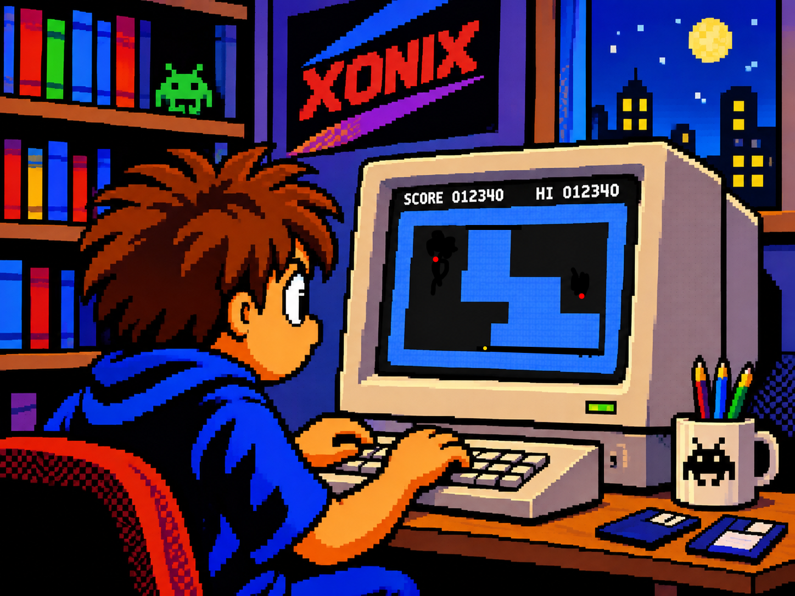
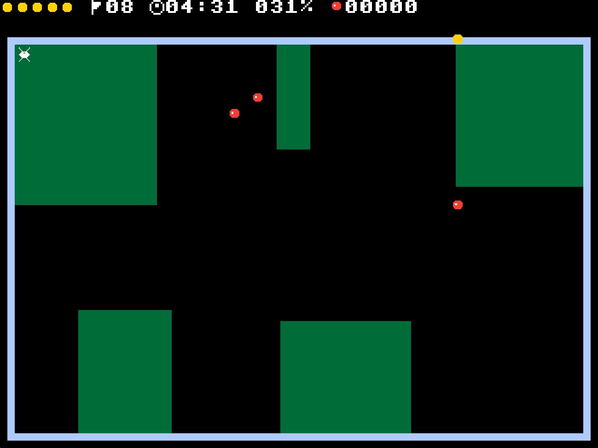

# zeal-xonix

A Xonix remake for the Zeal 8-bit Computer running Zeal 8-bit OS.

## Screenshots
<table>
  <tr>
    <td></td>
    <td></td>
  </tr>
</table>

## Requirements

Make sure that you have [ZDE](https://github.com/zoul0813/zeal-dev-environment) installed.

Install the ZGDK dependency and its required libraries once:

```sh
zde deps install zgdk
```

## Build

From this project directory, run:

```sh
zde cmake
```

## Run

From the Zeal 8-bit OS shell, on the disk that holds the binary:

```sh
./zeal-xonix.bin
```

`The HUD shows the
current level, remaining time, captured percentage and score.

## Splash screen

The optional intro splash is loaded at runtime from:

```
assets/splash.zts
assets/splash.ztp
assets/splash.ztm
```

next to the binary.  `zde cmake` copies ready-made splash files from the
project's `assets/` directory into `bin/assets/`.  If the files are present,
the splash is shown with a fade-in; press any key to continue, or wait 25
seconds.  It then fades out and level 1 starts.  If the files are missing, a
warning is printed on the text console and the game starts without the splash.

## High scores

When the player runs out of lives, the game shows the top ten results.  If the
score qualifies (it is greater than zero and either the table has fewer than
ten entries or the score beats the lowest one), the player is asked for a name.

The table is saved as `HISCORE.DAT` in the current directory, i.e. next to the
game binary when it is started from its own folder.
A missing, truncated or corrupted file is treated as an empty
table.

#№ GAME DESIGN DOCUMENT (GDD)
Project: Xonix Remake (Level Balance Specification)

### GENERAL RULES AND GAME MECHANICS

* **Playfield:** A strict classic rectangle. The field geometry is static across all levels. There are no internal partitions, mazes, or obstacles.
* **Player:** Controls a device that cuts off parts of the field. Moves along captured territory and draws lines through neutral territory.
* **Enemies (Balls):** Located inside the uncaptured playfield. Bounce off walls and player lines at a 45-degree angle. 3 speed tiers are available: Slow, Medium, Fast. The maximum number of balls on the field is 5.
* **Enemies (Spiders):** Spiders have a single fixed speed that remains unchanged from level 1 to level 21. The maximum number of spiders per level is 2.

### SCORING AND VICTORY RULES

* **Victory Condition (Goal):** Capture at least 75% of the territory on any level.
* **Base Scoring:** 10 points for each 1% of captured area.
* **Risk Bonus (Level Score Multipliers):**
  * **From 75% to 84.9%** — Standard scoring (x1). Minimum passing result (75%) = 750 points.
  * **From 85% to 90.9%** — Doubling of earned extra points (above 75%) (x2). (Example: 85% = 750 + 10 * 10 * 2 = 950 points).
  * **From 91%** — Tripling of earned extra points (above 85%) (x3). (Example: 91% = 750 + 16 * 10 * 3 = 1230 points).
* **Time Bonus:** None. Remaining time on the timer yields 0 points. The timer serves strictly as a hard life limiter.

### LIVES AND CONTINUES SYSTEM

* **Starting Lives:** The player starts the game with 5 lives.
* **Losing a Life:** Occurs when a Ball collides with an incomplete player line, when a Spider collides with the player on the border, or when the time limit expires.
* **Level Progress Reset:** Upon losing a life, the current level restarts, the percentage of captured territory resets to 0%, and points earned during the current attempt are lost. Points earned on previous levels are preserved.

---

### LEVEL PROGRESSION (BALANCE AND DIFFICULTY GRID)

* Standard time to complete a level is 5 minutes.
* The movement speed of a "Medium ball" is 20% faster than a "Slow ball".
* The movement speed of a "Fast ball" is 40% faster than a "Slow ball".
* The movement speed of spiders is equal to half the movement speed of the player's sprite.

#### Stage 1: Introduction and the First Spider (Balls: 1–3, Spiders: 0–1)

* **Level 1** — 1 slow ball | 0 spiders | Time: Standard.
* **Level 2** — 1 medium ball | 0 spiders | Time: Standard.
* **Level 3** — 2 slow balls | 0 spiders | Time: Standard.
* **Level 4** — 2 medium balls | 0 spiders | Time: Standard.
* **Level 5** — 2 medium balls | 1 spider | Time: Standard.
* **Level 6** — 3 slow balls | 1 spider | Time: Standard.
* **Level 7** — 3 medium balls | 1 spider | Time: Standard.

#### Stage 2: Picking Up the Pace and the Second Spider (Balls: 3–4, Spiders: 1–2)

* **Level 8** — 3 fast balls | 1 spider | Time: Standard.
* **Level 9** — 3 fast balls | 1 spider | Time: Reduced by 15%.
* **Level 10** — 4 slow balls | 1 spider | Time: Standard.
* **Level 11** — 4 medium balls | 1 spider | Time: Standard.
* **Level 12** — 4 medium balls | 2 spiders | Time: Standard.
* **Level 13** — 4 fast balls | 2 spiders | Time: Standard.
* **Level 14** — 4 fast balls | 2 spiders | Time: Reduced by 25%.

#### Stage 3: Peak Loads (Balls: 5, Spiders: 2)

* **Level 15** — 5 slow balls | 2 spiders | Time: Standard.
* **Level 16** — 5 medium balls | 2 spiders | Time: Standard.
* **Level 17** — 5 medium balls | 2 spiders | Time: Reduced by 20%.
* **Level 18** — 5 fast balls | 2 spiders | Time: Standard.
* **Level 19** — 5 fast balls | 2 spiders | Time: Reduced by 20%.
* **Level 20** — 5 fast balls | 2 spiders | Time: Reduced by 35%.
* **Level 21: Final** — 5 fast balls | 1 spider | Time: Reduced by 45%.

## Real hardware

>[!NOTE]
>This game has been tested **only under the Zeal 8-bit OS reference
>emulator** — the author does not have a Zeal 8-bit computer at hand. There is
>**no guarantee it works on real hardware** (timing, video timing, SD/ROM
>behaviour and input can all differ), although nothing platform-specific is
>used beyond the standard SDK APIs. Testing on real hardware is very welcome.

## License

This project is a non-commercial fan remake created for preservation and educational purposes.  

[MIT](LICENSE)
